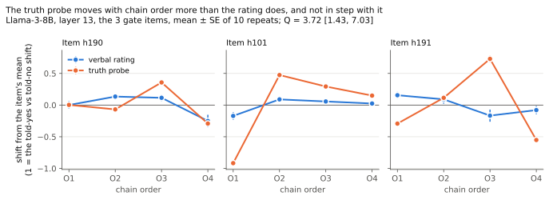

# Belief versus readout: does a truth probe move with question order? (gold map direction 5)

Pre-registered in `experiments/probe-dissociation.md` (D48, frozen in `9ef909d` before any call on the study items). Llama-3-8B-Instruct, 4-bit, run locally through MLX on an M2 Pro. 1,200 conversations, **$0 API**.

## In plain English

**The question.** When a model's 0–100 rating of a question changes with the order of the sub-questions asked before it, has its internal belief changed, or only the answer it puts together when asked?

**The method.** We read a standard truth probe inside an open 8B model at the moment it is asked the main question, after each of four orderings, and compared that reading with the rating it then gave.

**The answer is neither of the two outcomes the test was designed to tell apart.**
- **The rating does depend on order.** On the three items that passed the gate, the four orderings move it by 20–30 points. It mostly follows the last sub-claim asked: if that claim leaned "yes", the rating goes up.
- **The probe moves too, and by more.** Measure each in units of how far it moves when the model is told "a reliable source says the answer is yes" versus "… no". On that scale, the probe's order effect is about 3.7 times the rating's.
- **But the two move independently.** The orderings that raise the rating are not the ones that raise the probe. The probe does not follow the last sub-claim either.

So the internal truth signal is not a stable belief under a constructed answer, and it is not a belief that the answer reports. Something in the context moves it, and the verbal answer does not track it.

**Verdict, by the frozen rule: PROBE MOVES, BUT NOT WITH THE RATING.** The "clean dissociation" the gold map gave P = 0.30 did not happen.

*Figure.* For each gate item, the verbal rating (blue) and the truth probe (orange) after each chain order, as the shift from that item's mean. Each measure is in units of its own told-yes-versus-told-no shift, so 1 is what a decisive cue does. Mean ± SE of 10 repeats; the probe's SEs are smaller than the markers.

## Step 1: the gate

The ten items are experiment 5 run 2's, with the same claims, the same wording and one scale direction ("0 = certainly false, 100 = certainly true"). There were 10 repeats per cell, sampled at temperature 1.0 under a constraint equivalent to experiment 5's `{"rating": N}` schema.

| item | O1–O4 span (points) | order p | shows effect | B0 mean | Haiku O1–O4 span, anchor (a), R = 5 |
|---|---|---|---|---|---|
| h190 | 29.5 | 0.0011 | **yes** | 21.9 | 9.0 |
| h101 | 20.0 | 0.0004 | **yes** | 69.7 | 2.4 |
| h112 | 15.7 | 0.21 | no | 21.5 | 51.0 |
| h191 | 24.7 | 0.013 | **yes** | 40.4 | 2.0 |
| h261 | 41.5 | 0.10 | no | 74.2 | 8.6 |
| h058 | 25.0 | 0.063 | no | 78.5 | 19.0 |
| h221 | 8.9 | 0.48 | no | 46.3 | 7.0 |
| h279 | 12.8 | 0.29 | no | 44.0 | 16.0 |
| h127 | 18.9 | 0.24 | no | 50.5 | 17.0 |
| h238 | 6.5 | 0.12 | no | 78.7 | 9.8 |

**The gate passes on Llama, at exactly its threshold:** 3 of 10 items, against the required 3. Qwen2.5-7B was therefore not run.

Llama's spans are as large as Haiku's or larger, but its between-repeat noise is much larger too (median within-order SD 13.0 points, interquartile range 9.6–23.3, against Haiku's 2.9, IQR 2.1–5.5, over the same 40 cells). So only three items reach p < 0.05. Llama is also far more credulous after a chain: it rates the main question 70–100 where Haiku gave 3–20 on the same items.

## Step 2: the probe

Mass-mean probes (θ = μ_true − μ_false) were trained on Marks & Tegmark's six curated datasets, 300 statements each. **Layer 13** of 32 was selected on companies and counterfact (mean AUROC 0.90).

| dataset | role | AUROC | accuracy |
|---|---|---|---|
| cities, neg_cities, sp_en_trans, larger_than, smaller_than | train | 0.99–1.00 | 0.91–1.00 |
| neg_sp_en_trans | train | 0.99 | 0.58 |
| companies_true_false | selection | 0.94 | 0.87 |
| counterfact_true_false | selection | 0.86 | 0.76 |
| common_claim_true_false | report only | **0.88** | 0.79 |

The probe generalises well to statements it was not trained or selected on.

## Step 3: the test

Each conversation does two things at the main question:
1. **The probe.** It is read on the main question's yes-answer, written as a sentence (for example, "Louise M. Antony received her bachelor's degree in philosophy from Duke University."). The sentence goes in a side branch that is then erased.
2. **The rating.** The model then gives its rating in the untouched conversation.

Gate items G = h190, h101 and h191, as fixed in step 1.

| quantity | value [95% CI] | meaning |
|---|---|---|
| D_V, rating shift from told-no to told-yes (10 items) | 76.7 [60.8, 89.8] points | V3 passes: the cue moves the rating |
| D_P, probe shift from told-no to told-yes | 0.250 [0.191, 0.313] | V2 passes: the cue moves the probe |
| p_V, verbal order effect on G (new data) | 0.0001 | V4 passes: step 1's order effect replicates |
| p_P, probe order effect on G | **0.0001** | the probe does *not* hold within its noise |
| **Q**, probe order effect ÷ rating order effect, each in told-range units | **3.72 [1.43, 7.03]** | the probe moves more than the rating |
| **r**, correlation of order means (probe vs rating, 12 cells) | **+0.31 [−0.49, +0.99]** | the direction is not tied to the rating |

All four validity checks pass. The probe moves with order (p_P < 0.05), but r's interval includes 0. The frozen verdict is **PROBE MOVES, BUT NOT WITH THE RATING.**

**The probe's noise floor is tiny, and order clears it easily.** On the gate items:
- **Between repeats in one order:** the probe's SD is 0.016–0.030, or 1% of the probe's typical true-versus-false separation on held-out statements.
- **Between orders:** the noise-corrected SD is 0.07–0.16, or 6% of that separation.
- **The told cue:** 12% of the separation.

So, measured by its own range, the probe is far less movable by testimony than the rating is: 12% of a true-versus-false gap, against 77 of 100 points. Yet order moves it about half as far as testimony does.

### Sensitivity (reported, not part of the verdict)

| analysis | Q [95% CI] | r [95% CI] | rule would say |
|---|---|---|---|
| **primary: layer 13, statement token, gate items** | 3.72 [1.43, 7.03] | +0.31 [−0.49, +0.99] | probe moves, not with the rating |
| layer 11 | 3.61 [2.25, 5.83] | +0.60 [+0.36, +0.81] | belief moves (fully) |
| layer 15 | 2.92 [1.00, 5.92] | +0.25 [−0.30, +0.91] | probe moves, not with the rating |
| M-prompt position (last token before the rating) | 3.39 [1.60, 6.58] | +0.15 [−0.63, +0.95] | probe moves, not with the rating |
| all 10 items | 4.79 [2.17, 6.79] | +0.06 [−0.25, +0.37] | probe moves, not with the rating |

- **Robust:** "the probe moves with order, and more than the rating" holds in every row (every Q interval is at or above 1).
- **Fragile:** whether its movement is aligned with the rating depends on the layer. Layer 11 says yes, with r = +0.60. The primary layer, layer 15, the M-prompt position and all ten items say no. The all-ten-items row, with 40 cells, is the most precise, at r = +0.06 [−0.25, +0.37].

### Exploratory (after the verdict; `results/probe-dissociation-explore.json`)

**What the movement follows.** Correlations over all 40 item × order cells, with item-bootstrap CIs:
- **The rating follows the last sub-claim asked:** its correlation with that claim's lean (yes or no) is **+0.54 [+0.37, +0.74]**. This is a recency effect, like the one experiment 5's belief-adjustment model BA5 captured for Haiku.
- **The probe does not follow the last claim:** +0.14 [−0.23, +0.46] against its lean, and −0.16 [−0.56, +0.34] against the rating it received.

What does drive the probe's order effect is not identified here.

**Without any chain (B0).** The probe and the rating each rank the ten items against the gold answer at AUROC 0.875. With n = 10, that is only a sign that both carry some real knowledge of these items.

## What this means for the project

- **For direction 5's question.** On this model, the internal truth signal for the main statement is *not* a fixed belief under an order-dependent readout, which was the gold map's "clean dissociation".
  - The probe reacts to the sequence of prior questions, and more strongly than the rating does, relative to each one's response to decisive testimony.
  - The rating's order effect is mostly recency, and the probe does not share it.
  - The two are dissociated in a different sense: they move for different reasons.
- **It fits the overnight picture, with a twist.** Behaviourally, the answer is largely constructed by the asking (NSIT, six formats). Internally, there is no stable belief underneath that construction to fall back on either, at least none that a linear truth probe at layers 11–15 can find.
- **The probe is barely moved by testimony.** It moves 12% of a true/false gap when told the answer, against 77 points for the rating. So its in-context sensitivity is low, and the orderings move it more than testimony does relative to that low range. This may mean the probe reads stored knowledge more than in-context belief. A probe trained on in-context true and false statements would test that.

## Limits

- **One model and three gate items.** The direction-of-tracking statistic r rests on 12 cells, which is why its interval is so wide.
- **One readout sentence per item.** It was written by hand before any data. A rewording might move the probe differently.
- **One probe family.** These are mass-mean probes trained on context-free statements. Contrast-consistent or in-context-trained probes could behave differently.
- **Credulity.** Llama is much more credulous than Haiku after a chain, so this is not a replication of Haiku's internals. It is a replication of the behaviour (graded order effects) in a model whose internals can be read.

## Files

- `experiments/probe-dissociation.md` (pre-registration);
- `experiments/probe_dissociation.py` (gate, train, run, analyse, simulate);
- `experiments/local_lm.py` (MLX backend);
- `experiments/probe_dissociation_explore.py`;
- `experiments/probe_dissociation_figure.py`;
- `results/probe-dissociation-llama3-8b-{gate,gate-summary,probes,run}.json`;
- `results/probe-dissociation-llama3-8b-theta.npz` (the probe directions);
- `results/probe-dissociation.json` and `results/probe-dissociation-explore.json`;
- `paper/figures/fig3-probe-dissociation.{svg,png}`.

**To reproduce:** set up a venv with `mlx mlx-lm numpy scipy matplotlib`, then run `python experiments/probe_dissociation.py gate llama3-8b`, then `train`, `run` and `analyse`.
