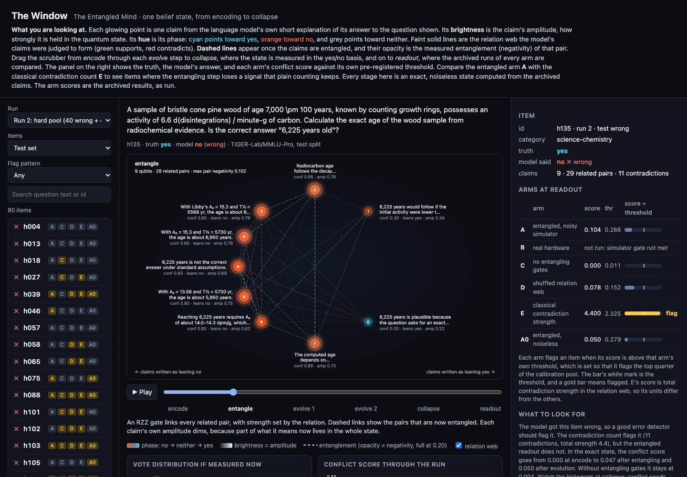

# The window

A visual display of one belief state at a time: the model's claims as a point cloud, brightness = amplitude, hue = phase (cyan yes, orange no), dashed links = entanglement with opacity = negativity, and a scrubber from encode through each evolution step to collapse and readout. The side panel compares every arm's archived conflict score against its own threshold.

```bash
.venv/bin/python experiments/export_window.py   # regenerate window/data/ (about 3 minutes; simulation only, no API keys)
python3 -m http.server -d window 8000           # then open http://localhost:8000/
```

Deep links: `http://localhost:8000/?item=h135&stage=1` (stages 0-5: encode, entangle, evolve 1, evolve 2, collapse, readout). Keys: left and right arrows step through the stages; space plays.

- **Stages** are exact, noiseless statevectors rebuilt from the archived claims with `src/entangled_mind` (read-only). The staged evolution is checked against the full circuit, and the final conflict score against archived arm A0 (mean absolute difference 0.016 over 425 items, which is sampling noise for 1,000 shots).
- **Arm scores and flags** are the archived results in `results/stage2-run-{1,2}.json`. The export reproduces every arm's published flag counts.
- **The per-stage AUROC line** in the trajectory card is exploratory, not pre-registered.


